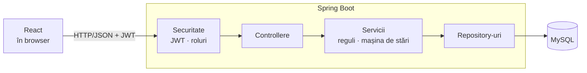
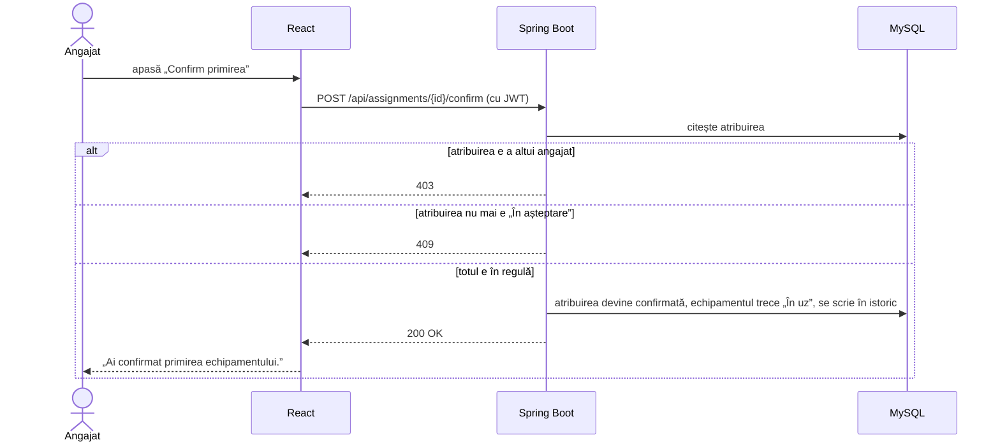
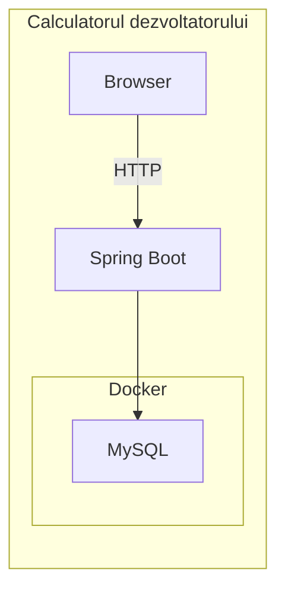

# Arhitectura aplicației

[← Înapoi la README](../README.md)

Aplicația are trei componente care rulează separat:

1. **Frontend**: o aplicație React care rulează în browser
2. **Backend**: un API REST scris în Spring Boot
3. **Baza de date**: MySQL

Frontend-ul și backend-ul comunică prin **HTTP cu JSON**


Am ales această variantă pentru că echipa e împărțită pe frontend și backend, și ne permite să lucrăm independent



## Backend

Codul este împărțit **pe domenii**. Fiecare domeniu are propriul controller, serviciu, repository și entități.

| Domeniu | Ce conține |
|---|---|
| `auth` | login |
| `users` | utilizatori, roluri, departamente |
| `equipment` | echipamentele |
| `assignments` | atribuire, confirmare, refuz, anulare, returnare |
| `audit` | istoricul operațiunilor |
| `alerts` | alertele de garanție |


## Exemplu de flux: confirmarea unei atribuiri

Vezi și [UC-1](use-cases.md#uc-1-atribuirea-unui-echipament-și-confirmarea-primirii).



## Securitate

- Parolele nu sunt salvate niciodată în text clar
- Fiecare endpoint are declarat rolul permis. În plus, un angajat poate confirma sau refuza doar atribuirile lui

## Tratarea erorilor

Orice eroare ajunge la frontend în același format:

```json
{
  "status": ...,
  "error": "Conflict",
  "message": "example"
}
```

Frontend-ul afișează direct câmpul `message`, care e scris în română.

## Rulare locală

