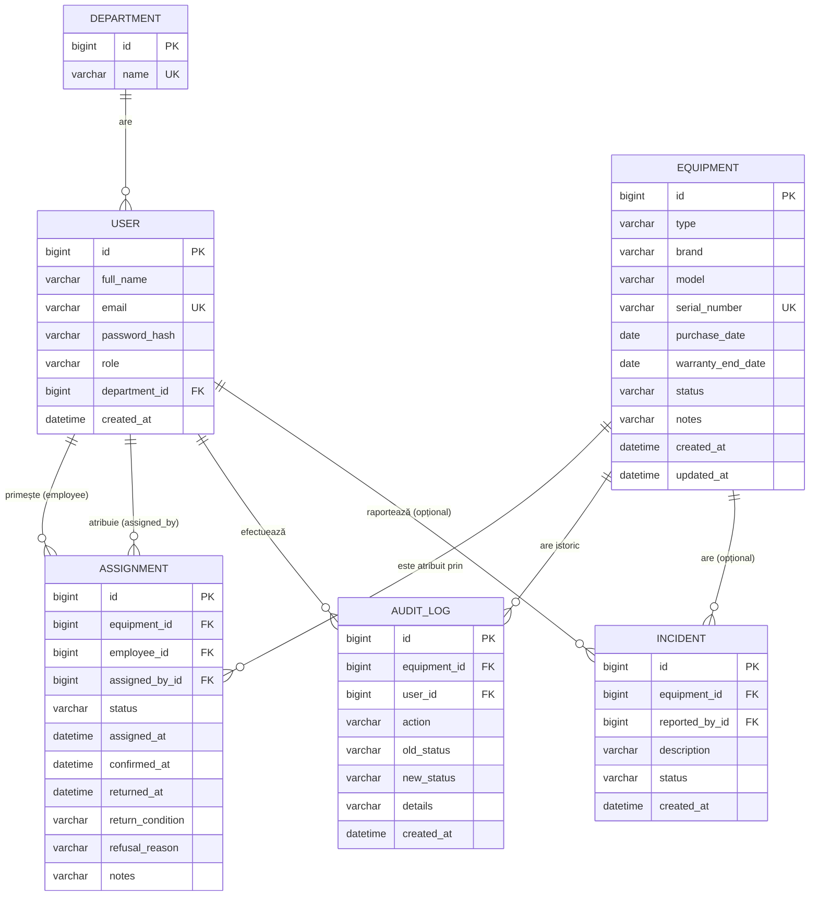

# Modelul de date și API-ul

[← Înapoi la README](../README.md)

## Diagrama entitate-relație

## Entități

### Department

Departamentele firmei. Sunt o listă fixă (de exemplu IT, Vânzări, Financiar, Resurse umane)

| Câmp | Tip | Constrângeri |
|---|---|---|
| `id` | bigint | cheie primară |
| `name` | varchar(100) | obligatoriu, unic |

### User

Utilizatorii aplicației

| Câmp | Tip | Constrângeri |
|---|---|---|
| `id` | bigint | cheie primară |
| `full_name` | varchar(100) | obligatoriu |
| `email` | varchar(150) | obligatoriu, unic; folosit la login |
| `password_hash` | varchar(100) | obligatoriu |
| `role` | varchar(20) | `EMPLOYEE`, `IT_STAFF` sau `MANAGER` |
| `department_id` | bigint | cheie străină către `department` |
| `created_at` | datetime | setat la creare |

### Equipment

Un echipament fizic din lista

| Câmp | Tip | Constrângeri |
|---|---|---|
| `id` | bigint | cheie primară |
| `type` | varchar(20) | diferite device-uri |
| `brand` | varchar(50) | obligatoriu |
| `model` | varchar(100) | obligatoriu |
| `serial_number` | varchar(100) | obligatoriu |
| `purchase_date` | date | obligatoriu |
| `warranty_end_date` | date | opțional; trebuie să fie după data achiziției |
| `status` | varchar(20) | `AVAILABLE`, `IN_USE`, `IN_SERVICE`, `RETIRED`; implicit `AVAILABLE` |
| `notes` | varchar(500) | opțional |
| `created_at`, `updated_at` | datetime | setate automat |

### Assignment

Atribuirea unui echipament către un angajat, de la creare până la returnare

| Câmp | Tip | Constrângeri |
|---|---|---|
| `id` | bigint | cheie primară |
| `equipment_id` | bigint | cheie străină către `equipment` |
| `employee_id` | bigint | cheie străină către `user`; angajatul care primește |
| `assigned_by_id` | bigint | cheie străină către `user`; responsabilul IT care atribuie |
| `status` | varchar(20) | `PENDING`, `CONFIRMED`, `REFUSED`, `CANCELLED`, `RETURNED` |
| `assigned_at` | datetime | setat la creare |
| `confirmed_at` | datetime | setat la confirmare |
| `returned_at` | datetime | setat la returnare |
| `return_condition` | varchar(20) | `GOOD`, `WORN`, `DEFECTIVE`; obligatoriu la returnare |
| `refusal_reason` | varchar(500) | obligatoriu la refuz |
| `notes` | varchar(500) | opțional |

**Regulă:** un echipament are cel mult o atribuire cu statusul `PENDING` sau `CONFIRMED`. Regula este verificată în serviciu, înainte de a crea o atribuire nouă.

### AuditLog

Istoricul operațiunilor pe echipamente. Se scrie în aceeași tranzacție cu operațiunea și **nu se modifică și nu se șterge niciodată**.

| Câmp | Tip | Constrângeri |
|---|---|---|
| `id` | bigint | cheie primară |
| `equipment_id` | bigint | cheie străină către `equipment` |
| `user_id` | bigint | cheie străină către `user`; cine a făcut operațiunea |
| `action` | varchar(30) | `CREATED`, `UPDATED`, `ASSIGNED`, `CONFIRMED`, `REFUSED`, `CANCELLED`, `RETURNED`, `SENT_TO_SERVICE`, `REPAIRED`, `RETIRED` |
| `old_status` | varchar(20) | starea echipamentului înainte; poate lipsi dacă starea nu se schimbă |
| `new_status` | varchar(20) | starea echipamentului după |
| `details` | varchar(500) | de exemplu angajatul, motivul refuzului sau al casării, starea fizică |
| `created_at` | datetime | setat la inserare |

### Incident (opțional)

O problemă tehnică raportată de angajat pentru un echipament pe care îl are în uz.

| Câmp | Tip | Constrângeri |
|---|---|---|
| `id` | bigint | cheie primară |
| `equipment_id` | bigint | cheie străină către `equipment` |
| `reported_by_id` | bigint | cheie străină către `user` |
| `description` | varchar(1000) | obligatoriu |
| `status` | varchar(20) | `OPEN`, `RESOLVED` |
| `created_at` | datetime | setat la creare |

## Relații

| Relație | Tip | Explicație |
|---|---|---|
| Department → User | 1 : N | un departament are mai mulți utilizatori, iar un utilizator aparține unui singur departament |
| Equipment → Assignment | 1 : N | un echipament are mai multe atribuiri în timp, dar cel mult una activă |
| User → Assignment | 1 : N | un angajat poate avea mai multe atribuiri, inclusiv simultan |
| Equipment → AuditLog | 1 : N | fiecare operațiune pe echipament adaugă o intrare în istoric |
| User → AuditLog | 1 : N | fiecare intrare păstrează cine a făcut operațiunea |
| Equipment → Incident | 1 : N | opțional |

## Endpoint-uri API

Toate endpoint-urile sunt sub `/api`, primesc și întorc JSON

**Roluri:** E = `EMPLOYEE`, IT = `IT_STAFF`, M = `MANAGER`.

### Autentificare

| Metodă | Cale | Rol | Descriere |
|---|---|---|---|
| POST | `/api/auth/login` | public | primește `{ email, password }`, întoarce token-ul și datele utilizatorului (nume, rol) |

### Utilizatori și departamente

| Metodă | Cale | Rol | Descriere |
|---|---|---|---|
| GET | `/api/users` | IT | lista utilizatorilor; `?role=EMPLOYEE` pentru alegerea angajatului la atribuire |
| POST | `/api/users` | IT | creează un cont |
| PUT | `/api/users/{id}` | IT | editează un cont |
| GET | `/api/departments` | E, IT, M | lista departamentelor |

### Echipamente

| Metodă | Cale | Rol | Descriere |
|---|---|---|---|
| GET | `/api/equipment` | IT, M | lista echipamentelor; filtre `?status=`, `?type=`, `?search=` |
| GET | `/api/equipment/{id}` | IT, M | detaliile unui echipament, inclusiv atribuirea activă |
| POST | `/api/equipment` | IT | adaugă un echipament |

### Atribuiri

| Metodă | Cale | Rol | Descriere |
|---|---|---|---|
| GET | `/api/assignments` | IT, M | lista atribuirilor; filtru `?status=PENDING` |
| POST | `/api/assignments` | IT | creează o atribuire; primește `{ equipmentId, employeeId, notes }` |

