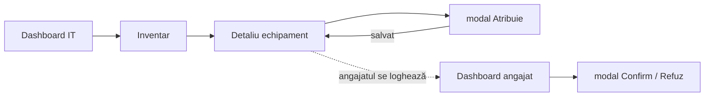
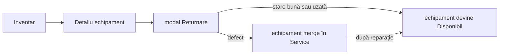
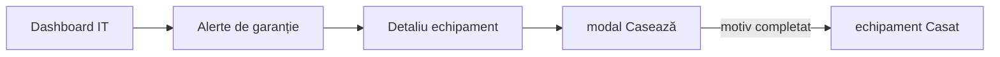

# Wireframe-uri

[← Înapoi la README](../../README.md)

Mai jos sunt schițele ecranelor principale și câteva note despre cum am gândit navigarea. Nu toate ecranele sunt la fel de detaliate unele sunt destul de simple și nu aveau nevoie de mult.

Acțiunile care cer date în plus (atribuire, refuz, returnare, casare) le-am pus în modal, ca să nu ieși din contextul în care ești.

---

## Culori pentru statusuri

Le-am stabilit de la început ca să fie consistente peste tot în interfață.

| Status | Cum apare în UI |
|---|---|
| Disponibil | badge verde |
| În uz | badge albastru |
| În service | badge portocaliu |
| Casat | badge gri, text sters |

---

## Login

Simplu email, parolă, buton. După login mergi automat la dashboard-ul rolului tău.

```
+----------------------------------+
|                                  |
|           AssetDesk              |
|                                  |
|  email                           |
|  [______________________________]|
|                                  |
|  parolă                          |
|  [______________________________]|
|                                  |
|       [  Intră în cont  ]        |
|                                  |
|  (mesaj eroare dacă e cazul)     |
|                                  |
+----------------------------------+
```

---

## Dashboard angajat

Prima pagină pe care o vede angajatul după login. Am vrut să fie clar ce are de făcut: dacă are ceva de confirmat, apare primul. Dacă nu are nimic, îi arătăm doar ce echipamente are.

```
AssetDesk          [Dashboard]  [Echipamentele mele]        [logout]
-------------------------------------------------------------------------

  Bună, Ion Popescu!

  +-- De confirmat (1) -------------------------------------------+
  |                                                               |
  |  Dell Latitude 5540   SN-DELL-001                          |
  |  atribuit de Maria Ionescu, 10 nov                           |
  |                                                               |
  |     [ Confirm primirea ]       [ Refuz ]                     |
  |                                                               |
  +---------------------------------------------------------------+

  +-- Echipamentele mele -----------------------------------------+
  |                                                               |
  |  [albastru] Monitor LG 27"  ·  SN-LG-004                    |
  |  [albastru] Mouse Logitech  ·  SN-LOG-012                    |
  |                                                               |
  +---------------------------------------------------------------+
```

Dacă nu are nimic de confirmat, secțiunea aia dispare. Dacă nu are niciun echipament, scriem ceva de genul „Nu ai echipamente în evidență."

---

## Dashboard responsabil IT

Ăsta e ecranul cu cea mai multă informație. L-am împărțit în trei zone: cifrele de ansamblu sus, alertele de garanție la mijloc (că ăsta e motivul principal să dai click pe dashboard), atribuirile în așteptare jos.

```
AssetDesk   [Dashboard] [Inventar] [Atribuiri] [Alerte] [Utilizatori]   [logout]
---------------------------------------------------------------------------------

  Bună, Maria!

  [ 48 disponibile ]  [ 31 în uz ]  [ 5 în service ]  [ 12 casate ]
     (verde)             (albastru)    (portocaliu)        (gri)


  Garanții care expiră curând                        [vezi toate →]
  -----------------------------------------------------------------
  Dell Latitude 5540          expiră 2 dec 2026
  iPhone 14                   expiră 8 dec 2026
  HP LaserJet M404            expiră 15 dec 2026


  Atribuiri în așteptare                             [vezi toate →]
  -----------------------------------------------------------------
  Dell XPS 15      →   Andrei Mureșan     (din 9 nov)
  Monitor Samsung  →   Elena Stan         (din 10 nov)
```

Cifrele de sus sunt clickabile și duc la inventar cu filtrul aplicat (ex. click pe „5 în service" duce la inventar filtrat pe IN_SERVICE).

---

## Dashboard manager

Mai simplu față de cel IT managerul nu face operațiuni, doar se uită. I-am dat cifrele și alertele, fără lista de atribuiri în așteptare (nu e treaba lui).

```
AssetDesk      [Dashboard] [Inventar] [Atribuiri] [Alerte]          [logout]
-----------------------------------------------------------------------------

  [ 48 disponibile ]  [ 31 în uz ]  [ 5 în service ]
     (verde)             (albastru)    (portocaliu)

  Garanții care expiră în 30 de zile  (3 echipamente)
  ----------------------------------------------------
                              [Vezi alerte →]
```

---

## Inventar

Tabelul principal cu toate echipamentele. Filtrele sunt importante responsabilul IT le folosește des ca să găsească rapid ce caută.

```
AssetDesk   [Dashboard] [Inventar] [Atribuiri] [Alerte] [Utilizatori]   [logout]
---------------------------------------------------------------------------------

  Inventar echipamente                          [+ Adaugă echipament]

  [🔍 caută după serie, marcă, model...]

  Stare: [toate ▼]    Tip: [toate ▼]    Departament: [toate ▼]

  -----------------------------------------------------------------------
  Tip     Marcă / Model          Serie         Stare         La cine e
  -----------------------------------------------------------------------
  Laptop  Dell Latitude 5540     SN-DELL-001   [albastru] În uz   Ion Popescu
  Monitor LG 27" 4K              SN-LG-004     [albastru] În uz   Ion Popescu
  Laptop  HP EliteBook 840       SN-HP-022     [verde] Disponibil   (neatribuit)
  Telefon iPhone 14              SN-APL-007    [portocaliu] Service  (neatribuit)
  -----------------------------------------------------------------------

  pagina 1 din 4    [< înapoi]  [înainte >]
```

Click pe orice rând din tabel deschide pagina de detaliu a echipamentului.

---

## Formular adăugare echipament

Destul de standard. Seria e câmpul cel mai important dacă există deja, primești eroare direct sub câmp, fără să pierzi restul datelor completate.

```
  Adaugă echipament

  Tip *
  [ Laptop ▼ ]

  Marcă *                   Model *
  [Dell____________]        [Latitude 5540________]

  Serie *
  [SN-DELL-001_____________]
  ⚠ Seria asta există deja în inventar.

  Data achiziției *         Garanție până la
  [01.11.2024_______]       [01.11.2026_______]

  Observații
  [_____________________________________________]

                        [Anulează]   [Salvează]
```

---

## Detaliu echipament

Ecranul unde se fac majoritatea acțiunilor. Am pus datele echipamentului sus, atribuirea activă (dacă există) la mijloc, istoricul jos. Butoanele de acțiune apar doar dacă starea echipamentului permite acțiunea respectivă.

```
← Inventar

Dell Latitude 5540                              [albastru] În uz
-----------------------------------------------------------------
Serie: SN-DELL-001          Tip: Laptop
Marcă: Dell                 Achiziție: 01.11.2024
Model: Latitude 5540        Garanție: 01.11.2026


Atribuire curentă
-----------------
Ion Popescu  (Dep. IT)
atribuit de Maria Ionescu  ·  5 nov 2026
confirmat  ·  5 nov 2026, 14:32

[ Înregistrează returnarea ]


-- dacă echipamentul ar fi disponibil, în loc de cele de mai sus:
[ Atribuie ]    [ Trimite în service ]    [ Casează ]
-- (casează apare gri și dezactivat dacă e In_Use)


Istoric
-------
05.11.2026  14:32   Confirmat de Ion Popescu
05.11.2026  10:15   Atribuit lui Ion Popescu de Maria Ionescu
01.11.2024  09:00   Adăugat de Maria Ionescu
```

---

## Atribuiri

Lista tuturor atribuirilor, cu filtru pe status. Butonul de anulare apare doar pe cele în așteptare.

```
Atribuiri

Status: [toate ▼]

  -------------------------------------------------------------------
  Echipament             Angajat          Status           Acțiuni
  -------------------------------------------------------------------
  Dell Latitude 5540     Ion Popescu      ⏳ În așteptare  [Anulează]
  Monitor LG 27"         Ion Popescu      ✓ Confirmată
  HP EliteBook 840       Elena Stan       ✗ Refuzată
  -------------------------------------------------------------------
```

---

## Echipamentele mele (angajat)

Similar cu dashboard-ul, dar mai detaliat. Angajatul vede tot ce are în grijă și poate acționa din această pagină.

```
Echipamentele mele

  De confirmat
  ------------
  Dell Latitude 5540  ·  SN-DELL-001
  Atribuit de Maria Ionescu, 10 nov
  [ Confirm primirea ]   [ Refuz ]


  În uz
  -----
  Monitor LG 27"  ·  SN-LG-004  ·  al tău din 02.10.2026
  Mouse Logitech  ·  SN-LOG-012  ·  al tău din 02.10.2026
```

---

## Alerte garanție

Simplu un tabel cu ce expiră, ordonat după dată. Click pe echipament duce la detaliu.

```
Garanții care expiră în următoarele 30 de zile

  -----------------------------------------------------------
  Echipament              Serie          Stare      Expiră
  -----------------------------------------------------------
  Dell Latitude 5540      SN-DELL-001   În uz       2 dec 2026
  iPhone 14               SN-APL-007    În service  8 dec 2026
  HP LaserJet M404        SN-HP-030     Disponibil  15 dec 2026
  -----------------------------------------------------------
```

---

## Utilizatori

Responsabilul IT creează și editează conturi de aici. Simplu.

```
Utilizatori                               [+ Adaugă utilizator]

  ---------------------------------------------------------
  Nume               Email               Rol
  ---------------------------------------------------------
  Ion Popescu        ion@firma.ro        Angajat      [Editează]
  Maria Ionescu      maria@firma.ro      Responsabil  [Editează]
  Dan Popa           dan@firma.ro        Manager      [Editează]
  ---------------------------------------------------------
```

---

## Navigare și fluxuri principale

### Cum arată meniul pe rol

Angajat vede: **Dashboard · Echipamentele mele**

Responsabil IT vede: **Dashboard · Inventar · Atribuiri · Alerte · Utilizatori**

Manager vede: **Dashboard · Inventar · Atribuiri · Alerte** (fără buton de adăugare nicăieri)

### Fluxul de atribuire



### Fluxul de returnare



### Fluxul alertă → casare


